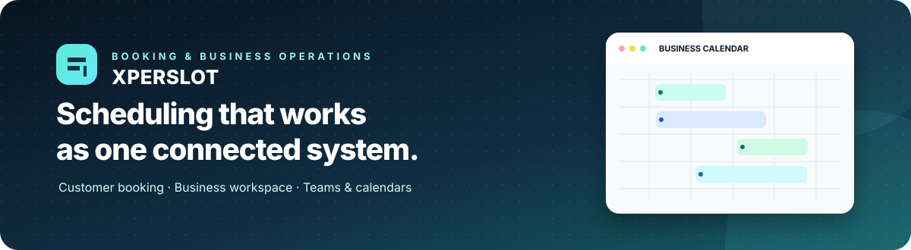
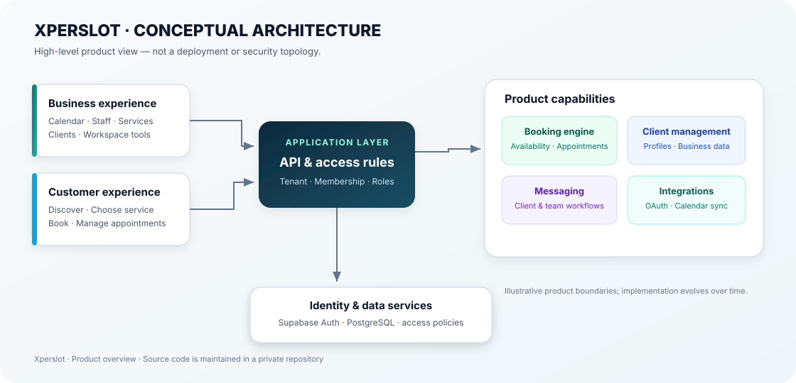

  

  <strong>A multi-tenant service-booking and business-operations platform delivered through two dedicated apps: Customer and Business.</strong>

  
  
  
  

XperSlot is an independently developed SaaS product for online service discovery, appointment booking, and day-to-day business workflows. Its current product structure consists of **two separate applications**, supported by shared services and tenant-aware access rules—not a single role-switching app.

**Official links:** [Android apps and release status](https://github.com/wondxpt/XperSlot-Downloads) · [Developer profile](https://github.com/wondxpt)

> **Release status — 11 November 2026:** The public download hub is being prepared for the current two-app product. No incomplete or older single-app build is offered as the current XperSlot product. APK downloads will be announced only after the exact Customer and Business binaries, signing continuity, and upgrade path have been verified.

## The two XperSlot apps

| XperSlot Customer | XperSlot Business |
| --- | --- |
| Discover service businesses and professionals | Configure business details and service catalogue |
| Explore categories, profiles, portfolios, and reviews | Manage availability, working hours, and booking rules |
| Choose services and book appointments | Work with calendars, appointments, and waitlists |
| Keep upcoming and past bookings organised | Organise staff, shifts, time off, resources, and commissions |
| Save favourites and contact providers | Maintain client records and customer communication |
| Manage a personal profile and booking journey | Access business operations such as checkout, inventory, reviews, and reporting where enabled |

Feature access can vary by account role, workspace configuration, and connected services. These are product-scope descriptions, not a claim that every listed capability is generally available or fully validated in the current public release.

## Why two apps?

Customers and service businesses have different goals and information needs. XperSlot separates the customer discovery-and-booking journey from the business workspace while connecting them through shared booking and account services. This keeps each app focused and avoids forcing both audiences into one role-switching interface.

## Conceptual architecture

  

The diagram shows product boundaries and responsibilities at a high level. It is **not** a deployment topology, a complete security design, or a guarantee that every integration is enabled in production.

## Engineering focus

- **Multi-tenant boundaries:** keep business data isolated and validate membership and permissions at the API and data layers.
- **Scheduling correctness:** keep service duration, staff availability, and appointment state consistent through booking workflows.
- **Communication flows:** connect customer conversations and internal team communication to the correct records and permissions.
- **Calendar integrations:** use explicit authorization and keep external events aligned with booking changes.
- **Cross-platform UX:** maintain coherent web and mobile behavior, including localization and right-to-left layouts.
- **Operational reliability:** make failures observable and validate journeys across the interface, API, and persistence layers.

## Technology

  
  
  
  
  
  
  
  

The intended stack supports typed web clients, Node.js APIs, managed authentication, PostgreSQL data services, and Android delivery. Exact implementation details and security-sensitive configuration remain in the private application repository.

## Release readiness

The public download hub tracks the release process separately from this product overview. A public APK release will be announced only after both current apps have passed the required checks:

1. Both Customer and Business APKs are attached to the same published release and GitHub reports each asset as fully uploaded.
2. Package IDs, app labels, version names, version codes, and minimum Android version are checked against the actual binaries.
3. SHA-256 checksums are published and verified against the downloadable files.
4. The signing certificate and in-place upgrade path are verified against previously distributed builds.
5. Fresh installation and update behavior are smoke-tested on physical Android devices without asking users to risk existing app data.
6. Sign-in, customer booking, business calendar, and backend-connected workflows are checked before release claims are made.

See [RELEASE_STATUS.md](https://github.com/wondxpt/XperSlot-Downloads/blob/main/RELEASE_STATUS.md) for the public status. Until those gates are cleared, the release remains **coming soon**.

## About the maker

Built by [Abbas Shiri](https://github.com/wondxpt), a developer focused on web and mobile products, SaaS architecture, and end-to-end workflows.

Also see [ResuMetrics](https://github.com/wondxpt/ResuMetrics), a separate resume/CV builder project.

---

XperSlot · Product overview · Proprietary application source maintained privately

